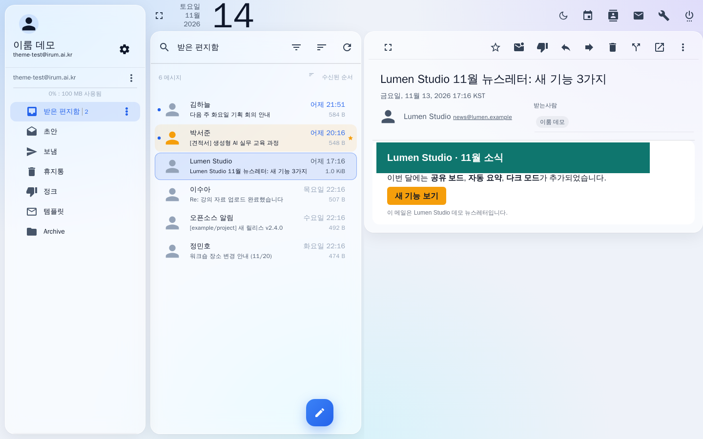
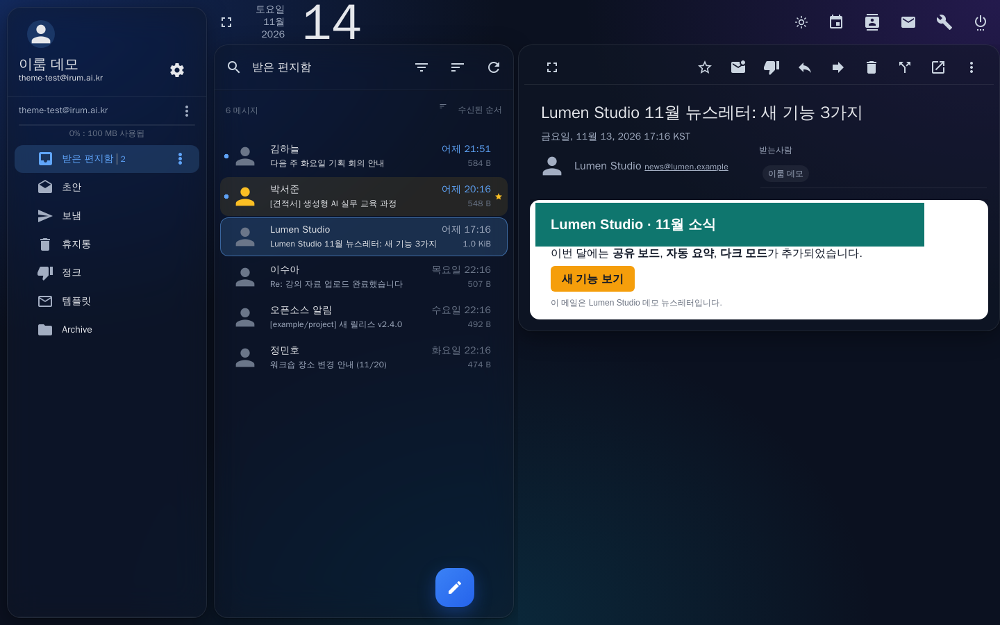
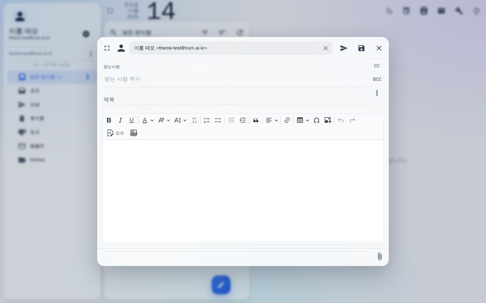
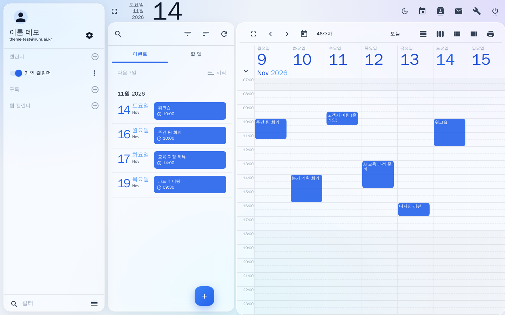
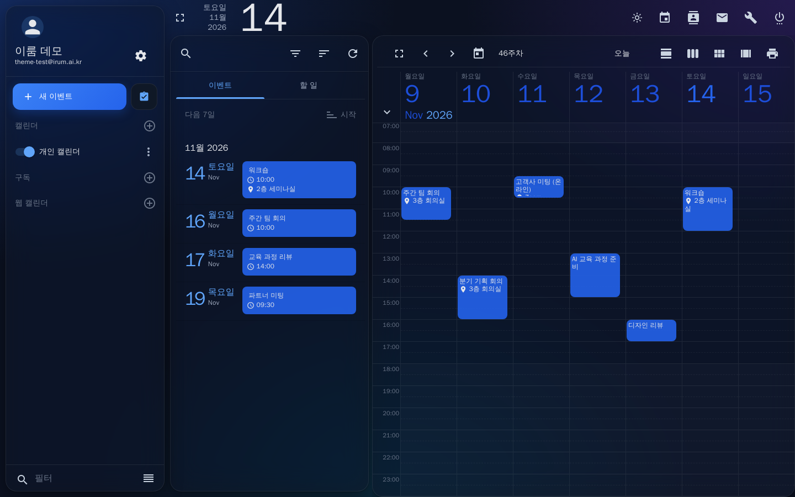
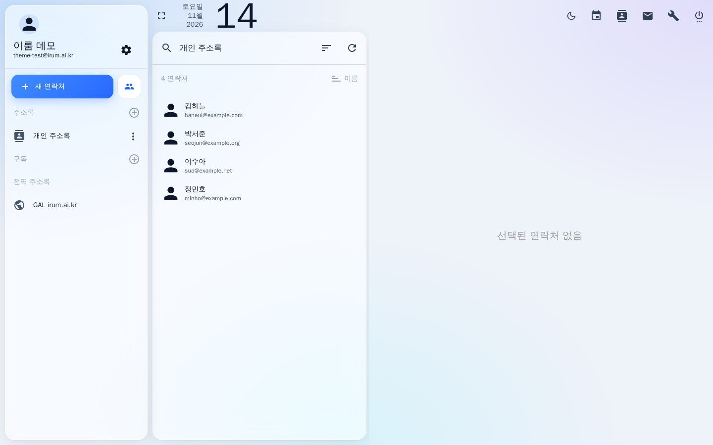
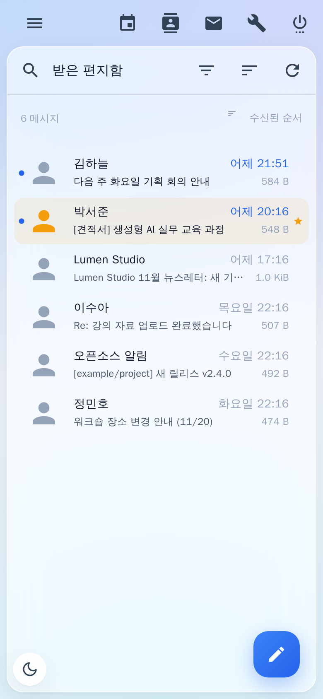
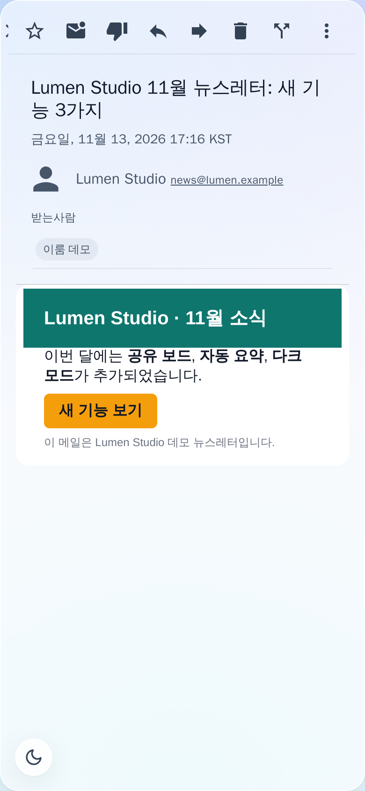

# SOGo Soft Glass Theme

[English](README.md) | **한국어**

[SOGo](https://www.sogo.nu/) 웹메일(메일·캘린더·주소록)용 **소프트 글래스** 테마입니다.
은은한 그라데이션 바탕 위에 반투명 유리 패널을 띄우고, 포인트 색은 차분한 블루 하나만 씁니다.
[mailcow](https://mailcow.email/)에서는 파일 하나만 바꾸면 적용됩니다.

## 스크린샷

**메일 — 라이트 모드**



| **메일 — 다크 모드** | **메일 쓰기** |
|---|---|
|  |  |
| **캘린더 — 라이트 모드** | **캘린더 — 다크 모드** |
|  |  |
| **주소록** | **휴대폰 — 메일 목록과 메일 보기** |
|  |   |

스크린샷의 샘플 메일, 이름, 일정은 모두 가상의 내용입니다.

## 특징

- **유리 패널** — 폴더, 메일 목록, 메일 보기가 흐림 효과(`backdrop-filter`)가 들어간 반투명 카드로 떠 있습니다.
- **포인트 색 하나** — 선택, 안 읽은 메일(점과 굵은 글씨), 새 메일 버튼, 탭, 스위치, 진행 막대를 블루(`#2563EB`) 하나로 통일했습니다.
- **메일 본문은 흰 종이** — HTML 뉴스레터의 원래 색을 그대로 보여 줍니다. 다크 모드에서도 본문과 편집기는 흰 종이로 둡니다.
- **라이트 / 다크** — 처음에는 운영체제 설정을 따르고, 상단 툴바의 해/달 버튼으로 바꿀 수 있습니다. 선택은 브라우저에 저장됩니다.
- **사이드바 맨 위 만들기 버튼** — 넓은 화면(1280px 이상)에서는 *새 메시지 작성*, *새 이벤트*, *새 연락처* 버튼이 목록 위에 떠 있지 않고 사이드바 맨 위에 있습니다. 옆의 작은 버튼은 두 번째 기능(새 창에서 쓰기, 새 할 일, 새 목록)입니다. 그보다 좁은 화면에서는 SOGo의 둥근 버튼을 그대로 씁니다.
- **캘린더 정리** — SOGo 기본의 베이지 격자선과 초록 탭을 연한 선과 포인트 색으로 바꿨습니다. 일정은 원색 블록 대신 캘린더 색이 은은하게 비치는 연한 블록에 테마 글자색으로 보이고, 색을 지정하지 않은 캘린더(SOGo 기본 회색)는 포인트 색을 씁니다.
- **대화상자와 팝업** — 메뉴, 일정 편집 창, 날짜·시간 선택, 주소 자동완성, 말풍선이 라이트·다크 모드에서 같은 색을 씁니다. 라디오 버튼, 체크박스, 슬라이더에 남아 있던 SOGo 기본 초록색도 포인트 색으로 바꿨습니다.
- **휴대폰 대응** — 좁은 화면에서 메일 보기가 목록 위에 겹쳐 뜰 때도 뒤가 비치지 않습니다.
- **접근성과 호환** — 투명 효과를 줄이는 설정(`prefers-reduced-transparency`)을 켠 사용자와 흐림 효과를 지원하지 않는 브라우저에는 불투명 패널을 씁니다. 인쇄할 때는 배경 없이 흰 종이로 나옵니다.
- **가벼움** — 외부 글꼴이나 이미지, 네트워크 요청이 없습니다. 스타일시트 하나와 버튼 몇 개를 추가할 뿐, 화면을 계속 감시하는 코드는 없습니다.

## 설치 (mailcow)

```bash
cd /opt/mailcow-dockerized        # mailcow 설치 경로
cp data/conf/sogo/custom-theme.js data/conf/sogo/custom-theme.js.bak   # 기존 파일 백업
curl -fsSL https://raw.githubusercontent.com/IrumAcademy/SOGo-Mail-Theme/main/soft-glass-theme.js \
  -o data/conf/sogo/custom-theme.js
docker compose restart sogo-mailcow memcached-mailcow
```

브라우저에서 웹메일을 **강력 새로고침**(Ctrl+Shift+R, macOS는 Cmd+Shift+R)하면 적용됩니다.

- mailcow는 `data/conf/sogo/custom-theme.js`를 SOGo의 `js/theme.js`로 연결해 둡니다. 따로 설정할 것은 없습니다.
- mailcow를 업데이트하면 이 파일이 기본값으로 돌아갈 수 있습니다. 그때는 위 명령을 다시 실행하세요.
- 되돌리려면 백업한 파일을 다시 복사하고 같은 방법으로 재시작하면 됩니다.

### mailcow가 아닌 SOGo

`soft-glass-theme.js`를 SOGo의 `WebServerResources/js/theme.js` 자리에 두면 됩니다. 패키지로 설치했다면 보통 `/usr/lib/GNUstep/SOGo/WebServerResources/js/theme.js`입니다. 그다음 SOGo를 재시작하세요.

## 포인트 색 바꾸기

`soft-glass-theme.js` 위쪽에서 아래 값을 같은 계열의 색으로 바꿉니다.

| 위치 | 용도 |
|---|---|
| `ACCENT` | 라이트 모드 포인트 색 |
| `PALETTE` | Angular Material 팔레트 (체크박스, 진행 막대, 링크 등) |
| CSS 토큰 `--ig-accent`, `--ig-accent-soft`, `--ig-accent-softer`, `--ig-accent-ring` | 라이트(`html.irum-glass`)와 다크(`html.irum-glass.irum-dark`)에 각각 한 번씩 |
| `.md-fab.md-accent`의 `linear-gradient` | 새 메일 버튼 |

배경 그라데이션은 `--ig-bg-grad`, 유리의 투명도는 `--ig-glass`, 흐림 정도는 `--ig-blur`에서 조절합니다.

## 호환

- SOGo 5.12 (mailcow 2026-10)에서 메일, 메일 쓰기(CKEditor 5), 캘린더, 주소록, 휴대폰 화면을 확인했습니다.
- 최신 Chrome, Edge, Safari, Firefox. `backdrop-filter`가 없는 브라우저는 불투명 패널로 대체합니다.
- 다른 버전의 SOGo에서는 일부 요소 이름이 달라 SOGo 기본 색이 남는 곳이 있을 수 있습니다. 발견하시면 이슈로 알려 주세요.

## AI 도우미로 설치하기

아래 프롬프트를 복사해서, 메일 서버에서 명령을 실행할 수 있는 AI 코딩 도우미(Claude Code, Codex 등)에 붙여 넣으세요.

```text
이 서버의 mailcow 웹메일에 "SOGo Soft Glass" 테마를 설치해 줘.

테마 파일: https://raw.githubusercontent.com/IrumAcademy/SOGo-Mail-Theme/main/soft-glass-theme.js
설명서: https://github.com/IrumAcademy/SOGo-Mail-Theme

순서:
1. mailcow-dockerized 폴더를 찾아. 보통 /opt/mailcow-dockerized 이고, 안에 mailcow.conf 와
   data/conf/sogo/custom-theme.js 가 있어. 찾지 못하면 나에게 물어봐.
2. 지금 테마를 백업해. data/conf/sogo/custom-theme.js 를
   data/conf/sogo/custom-theme.js.bak-<날짜> 로 복사하고, 이미 있는 백업은 덮어쓰지 마.
3. 위 테마 파일을 내려받아서 네트워크 요청이 없는 일반 JavaScript 인지 읽어서 확인하고,
   Node 가 있으면 `node --check` 로 문법을 검사한 뒤 data/conf/sogo/custom-theme.js 로 저장해.
4. 이 컨테이너들만 재시작해: docker compose restart sogo-mailcow memcached-mailcow
   (웹메일이 30초 정도 끊겨.)
5. 확인: SOGo 가 다시 응답할 때까지 기다린 뒤
   https://<메일 주소>/SOGo.woa/WebServerResources/js/theme.js 를 받아서
   설치한 파일과 체크섬이 같은지 확인해.
6. 백업 파일 이름, 확인 결과, 백업으로 되돌리는 명령 한 줄을 알려 주고,
   웹메일을 강력 새로고침(Ctrl+Shift+R)하라고 안내해 줘.

mailcow 의 다른 파일이나 컨테이너는 건드리지 마.
```

## 라이선스

[MIT](LICENSE) © 2026 IrumAcademy
