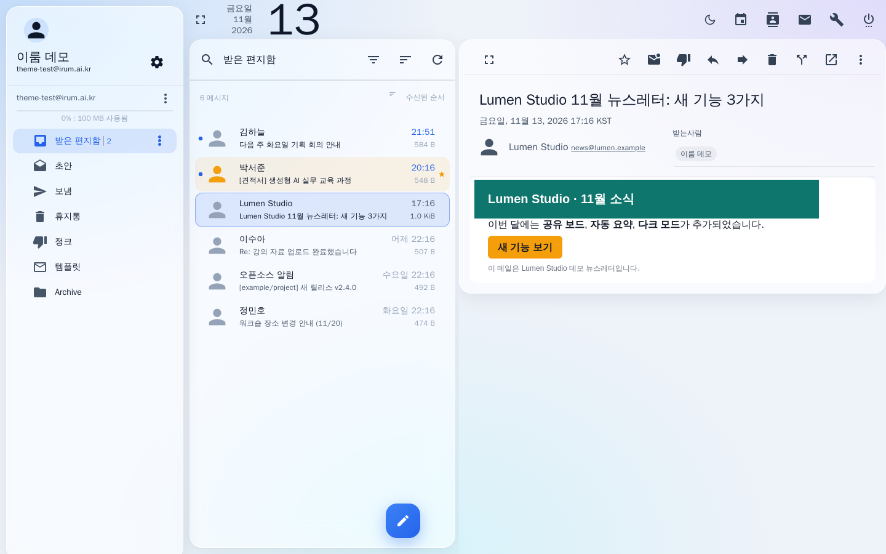
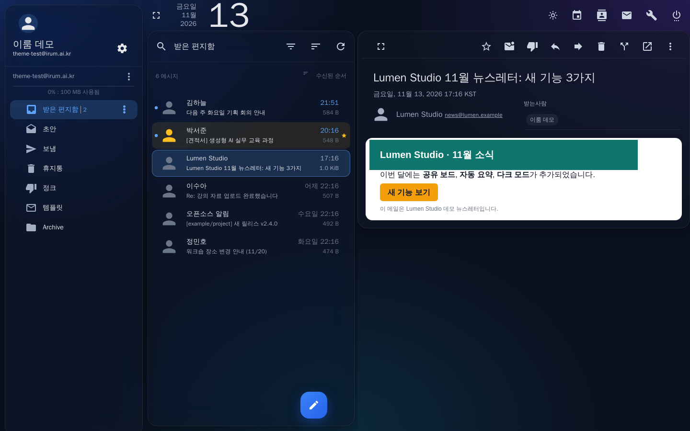
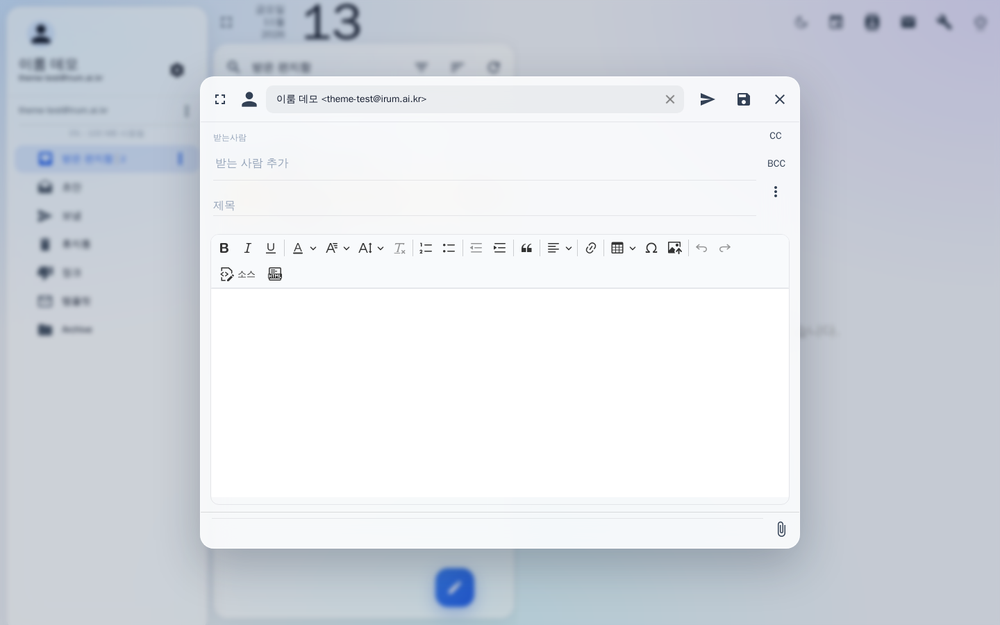
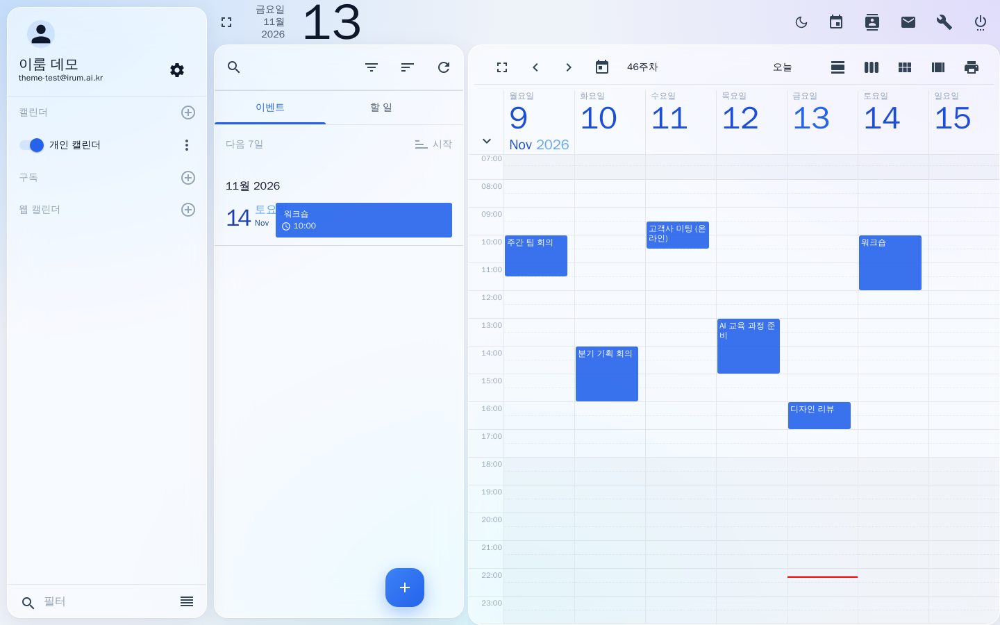
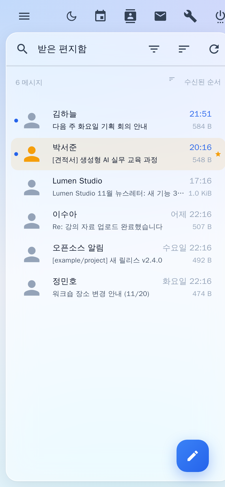
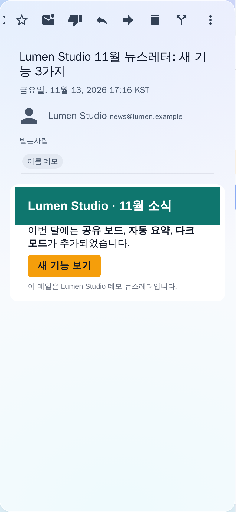

# SOGo Soft Glass Theme

**English** | [한국어](README.ko.md)

A soft-glass theme for the [SOGo](https://www.sogo.nu/) webmail (mail, calendar and contacts).
Frosted translucent panels float over a subtle gradient, and a single calm blue is used as the accent.
On [mailcow](https://mailcow.email/) it installs by replacing one file.



| Dark mode | Compose |
|---|---|
|  |  |
|  |  |

<p>
  
  
</p>

## Features

- **Glass panels.** Folders, the message list and the message view sit on translucent cards with a `backdrop-filter` blur.
- **One accent color.** Selection, unread mail (dot and bold text), the compose button, tabs, switches and progress bars all use one blue (`#2563EB`).
- **Message bodies stay on white paper.** HTML newsletters keep their own colors. In dark mode the message body and the editor stay white as well.
- **Light and dark.** The theme follows the operating system at first. The sun/moon button in the top toolbar switches it, and the choice is saved in the browser.
- **Cleaner calendar.** SOGo's beige grid lines and green tabs become faint lines and the accent color.
- **Mobile.** On narrow screens the message view slides over the list without the list showing through.
- **Accessibility and fallbacks.** Users with `prefers-reduced-transparency` and browsers without `backdrop-filter` get opaque panels. Printing uses plain white paper.
- **Lightweight.** No external fonts, images or network requests. The script adds one stylesheet and one button, and does not keep watching the page.

## Install on mailcow

```bash
cd /opt/mailcow-dockerized        # your mailcow directory
cp data/conf/sogo/custom-theme.js data/conf/sogo/custom-theme.js.bak   # back up the current file
curl -fsSL https://raw.githubusercontent.com/IrumAcademy/SOGo-Mail-Theme/main/soft-glass-theme.js \
  -o data/conf/sogo/custom-theme.js
docker compose restart sogo-mailcow memcached-mailcow
```

Then hard-reload the webmail (Ctrl+Shift+R, or Cmd+Shift+R on macOS).

- mailcow already mounts `data/conf/sogo/custom-theme.js` as SOGo's `js/theme.js`, so nothing else needs configuring.
- A mailcow update can reset this file to the default. Run the commands above again if that happens.
- To go back, copy the backup into place and restart the same way.

### SOGo without mailcow

Put `soft-glass-theme.js` in place of SOGo's `WebServerResources/js/theme.js`. For a package install this is usually `/usr/lib/GNUstep/SOGo/WebServerResources/js/theme.js`. Then restart SOGo.

## Changing the accent color

Change these values near the top of `soft-glass-theme.js` to colors from one family.

| Where | What it controls |
|---|---|
| `ACCENT` | Accent color in light mode |
| `PALETTE` | Angular Material palette (checkboxes, progress bars, links, …) |
| CSS tokens `--ig-accent`, `--ig-accent-soft`, `--ig-accent-softer`, `--ig-accent-ring` | Set once for light (`html.irum-glass`) and once for dark (`html.irum-glass.irum-dark`) |
| `linear-gradient` in `.md-fab.md-accent` | The compose button |

The background gradient is `--ig-bg-grad`, glass opacity is `--ig-glass`, and the blur strength is `--ig-blur`.

## Compatibility

- Tested on SOGo 5.12 (mailcow 2026-10): mail, compose (CKEditor 5), calendar, contacts and the mobile layout.
- Current Chrome, Edge, Safari and Firefox. Browsers without `backdrop-filter` get opaque panels.
- Other SOGo versions may name some elements differently, so a few places may keep SOGo's default colors. Please open an issue if you find one.

## License

[MIT](LICENSE) © 2026 IrumAcademy
