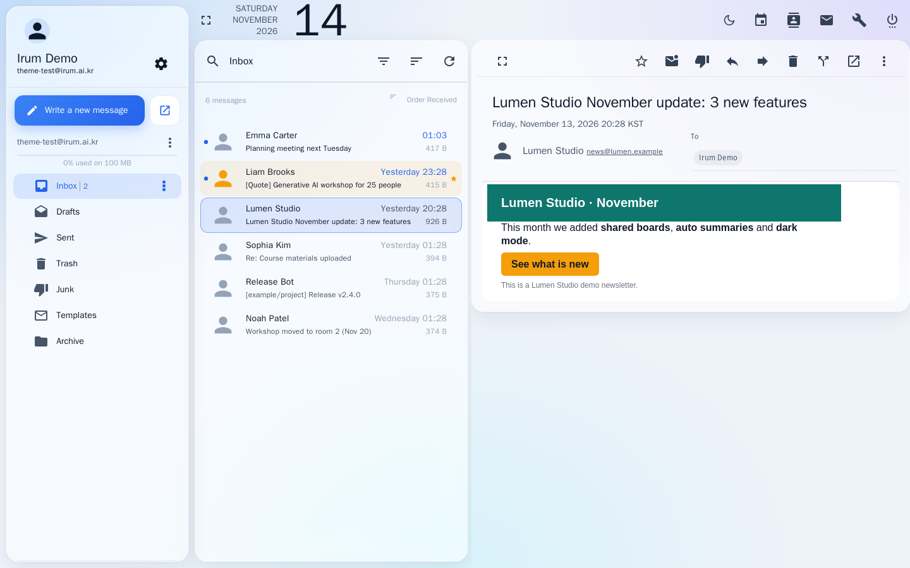
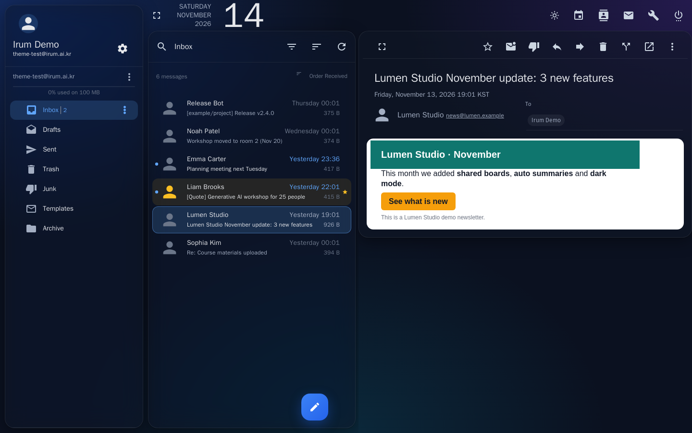
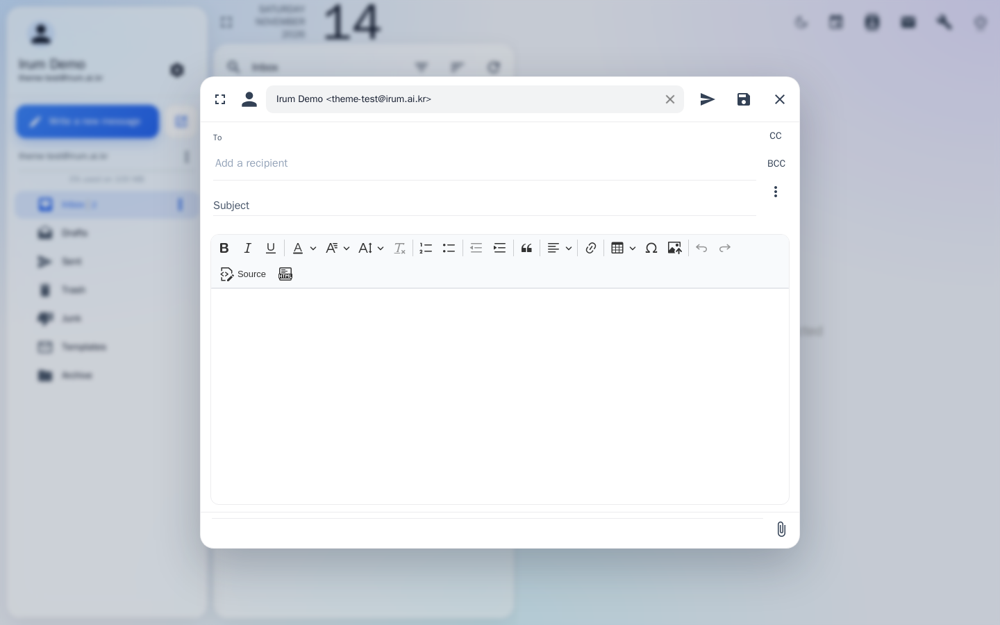
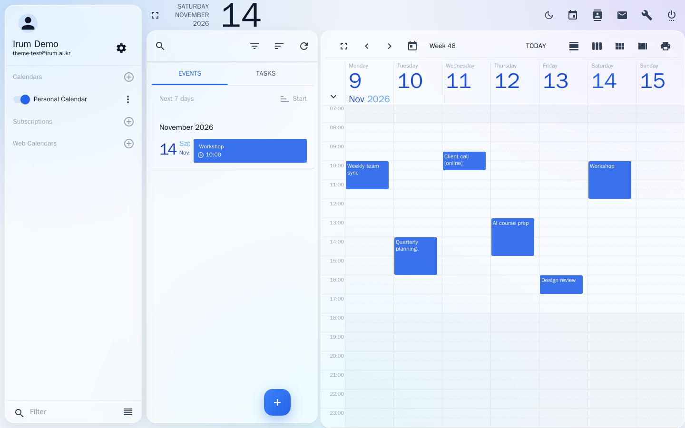
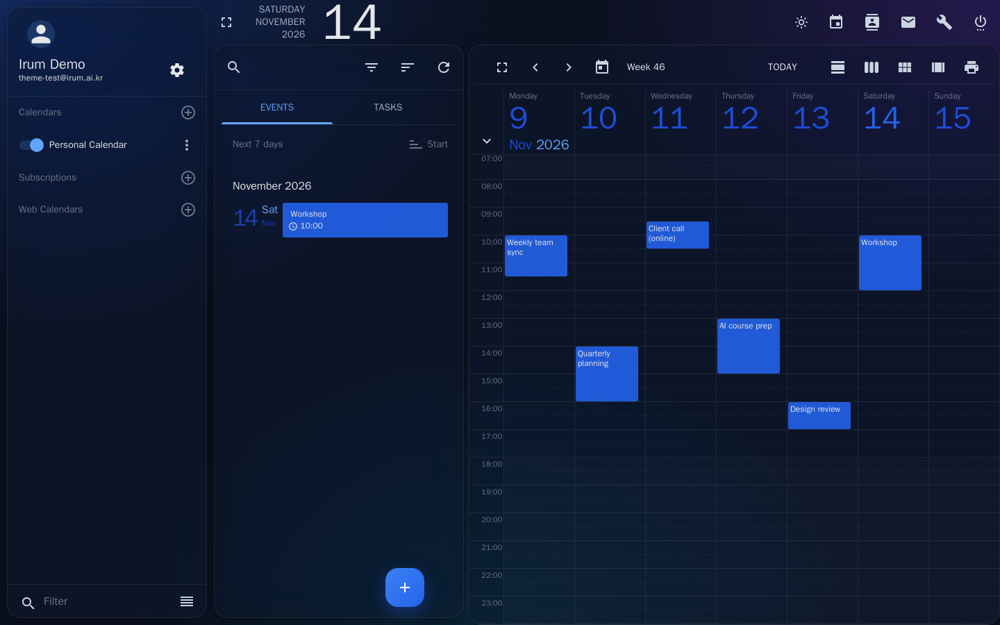
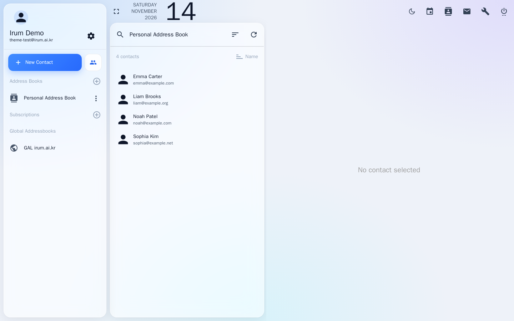
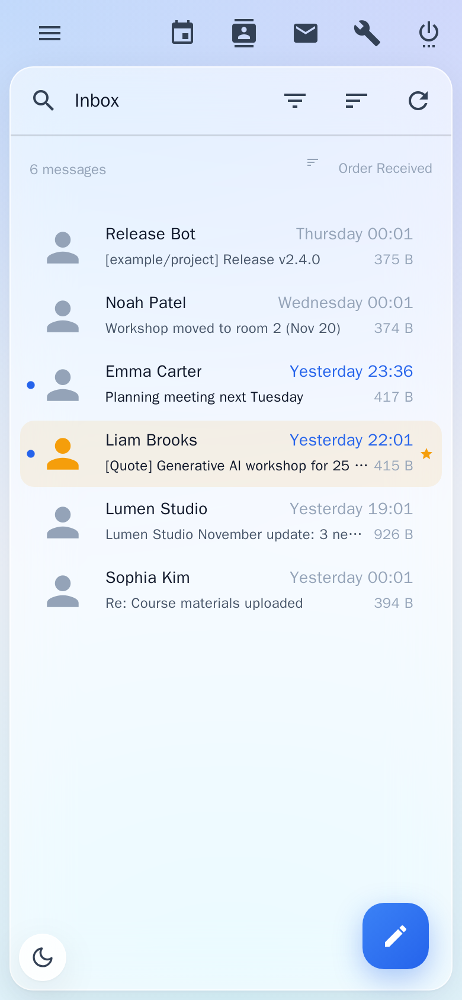
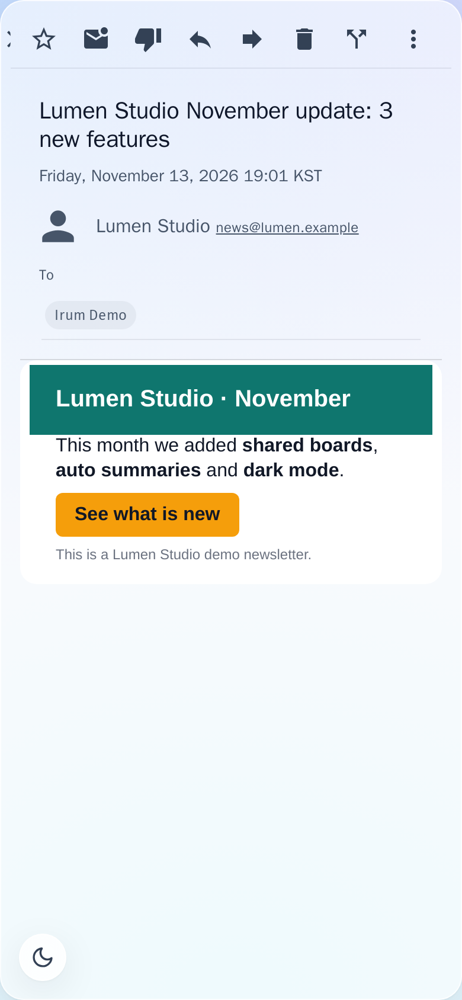

# SOGo Soft Glass Theme

**English** | [한국어](README.ko.md)

A soft-glass theme for the [SOGo](https://www.sogo.nu/) webmail (mail, calendar and contacts).
Frosted translucent panels float over a subtle gradient, and a single calm blue is used as the accent.
On [mailcow](https://mailcow.email/) it installs by replacing one file.

## Screenshots

**Mail — light mode**



| **Mail — dark mode** | **Compose** |
|---|---|
|  |  |
| **Calendar — light mode** | **Calendar — dark mode** |
|  |  |
| **Contacts** | **Mobile — inbox and message** |
|  |   |

The sample messages, names and events in these screenshots are fictional.

## Features

- **Glass panels.** Folders, the message list and the message view sit on translucent cards with a `backdrop-filter` blur.
- **One accent color.** Selection, unread mail (dot and bold text), the compose button, tabs, switches and progress bars all use one blue (`#2563EB`).
- **Message bodies stay on white paper.** HTML newsletters keep their own colors. In dark mode the message body and the editor stay white as well.
- **Light and dark.** The theme follows the operating system at first. The sun/moon button in the top toolbar switches it, and the choice is saved in the browser.
- **Create button at the top of the sidebar.** On wide screens (1280 px and up) *Write a new message*, *New Event* and *New Contact* sit at the top of the sidebar instead of floating over the list. The small button next to it runs the second choice (write in a new window, new task, new list). On narrower screens SOGo's round button stays.
- **Cleaner calendar.** SOGo's beige grid lines and green tabs become faint lines and the accent color. Events show as light blocks tinted with their calendar's color and use the theme's text color instead of solid blocks, and calendars without a chosen color (SOGo's default gray) use the accent color.
- **Dialogs and pop-ups.** Menus, the event editor, date and time pickers, address suggestions and tooltips use the same colors in light and dark mode, and SOGo's leftover green on radio buttons, checkboxes and sliders is replaced by the accent.
- **Mobile.** On narrow screens the message view slides over the list without the list showing through.
- **Accessibility and fallbacks.** Users with `prefers-reduced-transparency` and browsers without `backdrop-filter` get opaque panels. Printing uses plain white paper.
- **Lightweight.** No external fonts, images or network requests. The script adds one stylesheet and a few buttons, and does not keep watching the page.

## Install on mailcow

```bash
cd /opt/mailcow-dockerized        # your mailcow directory
cp data/conf/sogo/custom-theme.js data/conf/sogo/custom-theme.js.bak   # back up the current file
curl -fsSL https://raw.githubusercontent.com/IrumAcademy/SOGo-Mail-Theme/main/soft-glass-theme.js \
  -o data/conf/sogo/custom-theme.js
docker compose restart sogo-mailcow memcached-mailcow
```

Then hard-reload the webmail (Ctrl+Shift+R, or Cmd+Shift+R on macOS).

- mailcow already mounts `data/conf/sogo/custom-theme.js` as SOGo's `js/theme.js`, so nothing else needs configuring.
- A mailcow update can reset this file to the default. Run the commands above again if that happens.
- To go back, copy the backup into place and restart the same way.

### SOGo without mailcow

Put `soft-glass-theme.js` in place of SOGo's `WebServerResources/js/theme.js`. For a package install this is usually `/usr/lib/GNUstep/SOGo/WebServerResources/js/theme.js`. Then restart SOGo.

## Changing the accent color

Change these values near the top of `soft-glass-theme.js` to colors from one family.

| Where | What it controls |
|---|---|
| `ACCENT` | Accent color in light mode |
| `PALETTE` | Angular Material palette (checkboxes, progress bars, links, …) |
| CSS tokens `--ig-accent`, `--ig-accent-soft`, `--ig-accent-softer`, `--ig-accent-ring` | Set once for light (`html.irum-glass`) and once for dark (`html.irum-glass.irum-dark`) |
| `linear-gradient` in `.md-fab.md-accent` | The compose button |

The background gradient is `--ig-bg-grad`, glass opacity is `--ig-glass`, and the blur strength is `--ig-blur`.

## Compatibility

- Tested on SOGo 5.12 (mailcow 2026-10): mail, compose (CKEditor 5), calendar, contacts and the mobile layout.
- Current Chrome, Edge, Safari and Firefox. Browsers without `backdrop-filter` get opaque panels.
- Other SOGo versions may name some elements differently, so a few places may keep SOGo's default colors. Please open an issue if you find one.

## Install with an AI assistant

Copy the prompt below and paste it into an AI coding assistant that can run commands on your mail server (for example Claude Code or Codex).

```text
Install the "SOGo Soft Glass" theme on this server's mailcow webmail.

Theme file: https://raw.githubusercontent.com/IrumAcademy/SOGo-Mail-Theme/main/soft-glass-theme.js
Docs: https://github.com/IrumAcademy/SOGo-Mail-Theme

Steps:
1. Find the mailcow-dockerized directory (often /opt/mailcow-dockerized). It contains
   mailcow.conf and data/conf/sogo/custom-theme.js. Ask me if you cannot find it.
2. Back up the current theme: copy data/conf/sogo/custom-theme.js to
   data/conf/sogo/custom-theme.js.bak-<date>. Do not overwrite an existing backup.
3. Download the theme file above, read it to confirm it is plain JavaScript with no
   network requests, check it with `node --check` if Node is available, then save it
   as data/conf/sogo/custom-theme.js.
4. Restart only these containers: docker compose restart sogo-mailcow memcached-mailcow
   (the webmail is unavailable for about 30 seconds).
5. Verify: wait until SOGo answers again, then fetch
   https://<mail hostname>/SOGo.woa/WebServerResources/js/theme.js and confirm it has the
   same checksum as the file you installed.
6. Tell me the backup file name, the result of the check, and the one command that
   restores the backup. Remind me to hard-reload the webmail (Ctrl+Shift+R).

Do not change any other mailcow file or container.
```

## License

[MIT](LICENSE) © 2026 IrumAcademy
